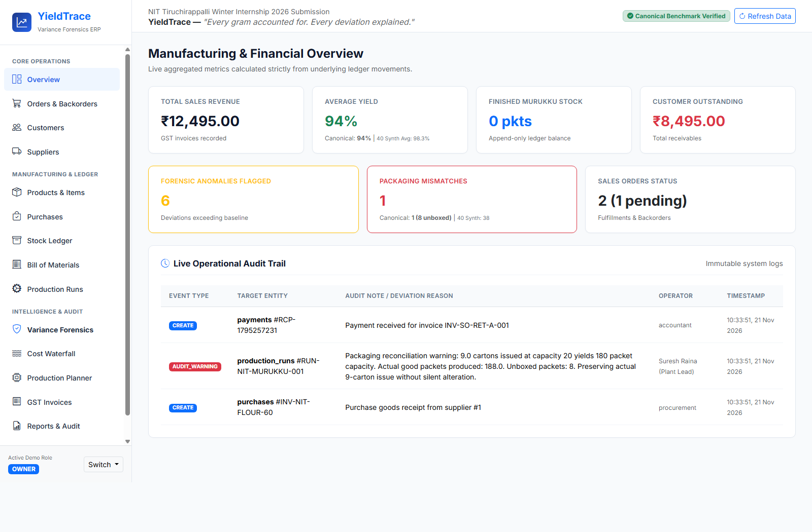
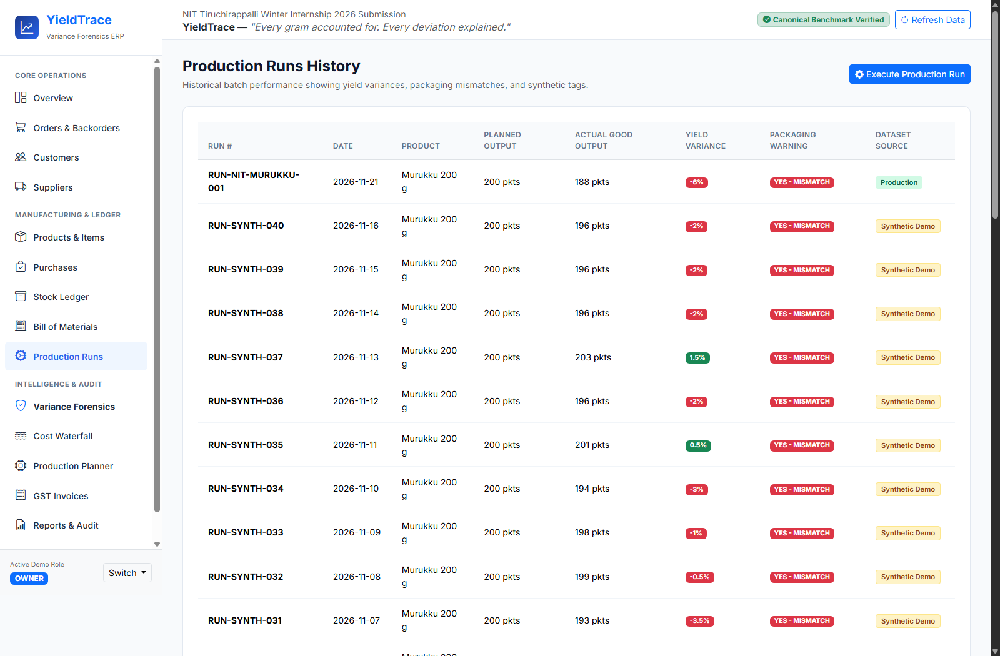
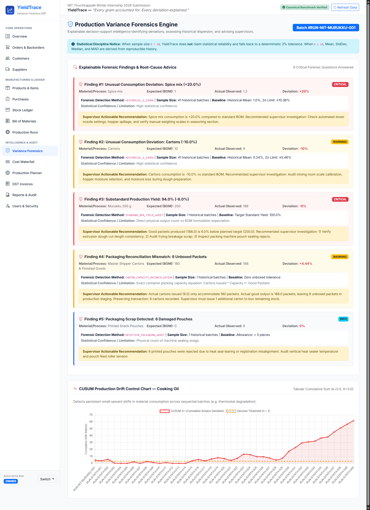
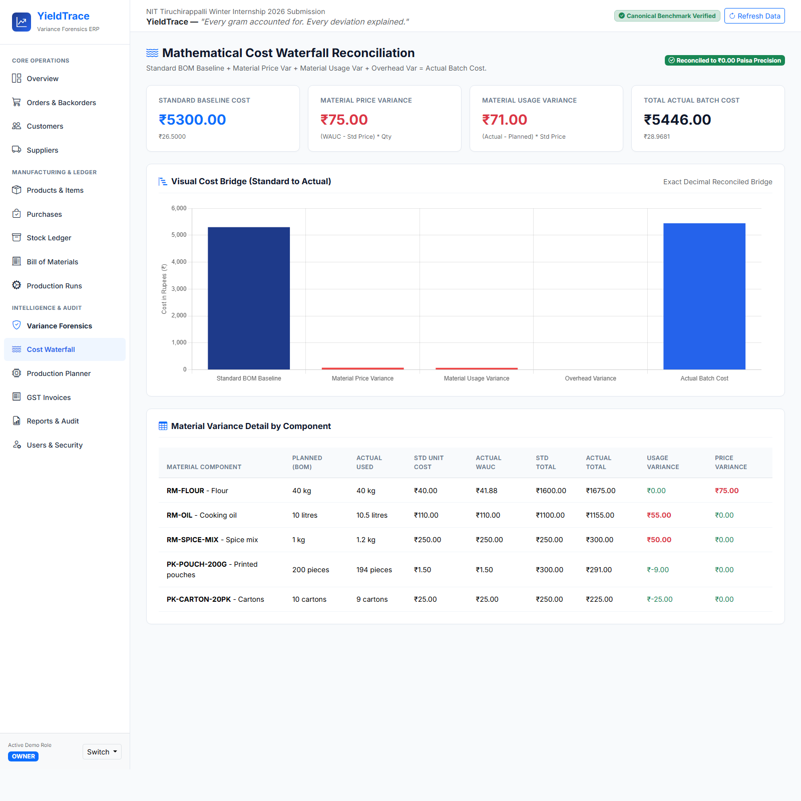
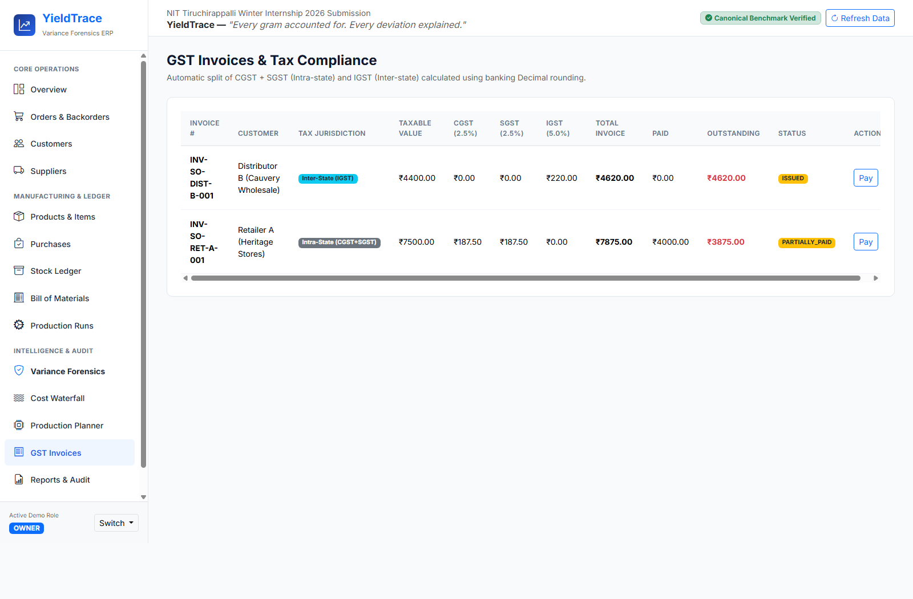
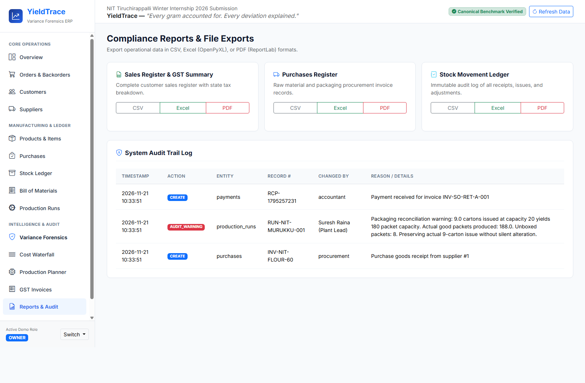

# YieldTrace — Production Variance Forensics & Audit Platform

> **"Every gram accounted for. Every deviation explained."**

**YieldTrace** is an intelligent, ledger-driven manufacturing ERP, Production Variance Forensics, and Audit Intelligence platform developed specifically for small-to-medium food manufacturers in India. Submitted to the **National Institute of Technology Tiruchirappalli (NIT Trichy), Centre for Digital Infrastructure, Winter Internship 2026**.

---

## Table of Contents
1. [Problem Statement](#1-problem-statement)
2. [Proposed Solution](#2-proposed-solution)
3. [Key Innovations](#3-key-innovations)
4. [Technology Stack](#4-technology-stack)
5. [Architecture & System Design](#5-architecture--system-design)
6. [Core Modules & Features](#6-core-modules--features)
7. [Production Variance Forensics Engine](#7-production-variance-forensics-engine)
8. [Mathematical Cost Waterfall Methodology](#8-mathematical-cost-waterfall-methodology)
9. [Canonical NIT Benchmark Verification](#9-canonical-nit-benchmark-verification)
10. [Visual Tour & Live Screenshots](#10-visual-tour--live-screenshots)
11. [Installation & Setup Instructions](#11-installation--setup-instructions)
12. [Database Seeding & Test Execution](#12-database-seeding--test-execution)
13. [Demo User Accounts & RBAC](#13-demo-user-accounts--rbac)
14. [Limitations & Future Enhancements](#14-limitations--future-enhancements)
15. [License & Authorship](#15-license--authorship)

---

## 1. Problem Statement

Small food manufacturers (packaged snacks, traditional sweets, bakeries, condiments) operate on razor-thin operating margins (8%–14%). In these manufacturing environments, margin leakage rarely stems from macro market conditions; it occurs silently on the factory floor:
- **Raw Material Over-Absorption:** Cooking oil degrading and absorbing 5%–15% beyond standard recipes due to failing fryer thermostats.
- **Dosing Inaccuracy:** Automated or manual spice dosers over-seasoning flour mixtures by 10%–25%.
- **Substandard Packet Yields:** Extrusion dough cutting errors or packaging machine jams destroying 5%–10% of finished output.
- **Packaging Reconciliation Losses:** Finished packets left unboxed in staging areas without carton capacity reconciliation, masking inventory theft or count discrepancies.
- **Arbitrary Balance Overwriting:** Traditional ERPs allow users to overwrite stock quantities directly (`UPDATE items SET balance = ...`), destroying historical audibility.

### The ERP Blind Spot
Generic ERP systems (Odoo, ERPNext, Tally) record *that* inventory decreased, but they cannot explain:
* **Why** the deviation happened;
* **Whether** the deviation is statistically unusual compared with history;
* **What** the plant supervisor should physically investigate; or
* **How** the financial variance bridges the standard recipe cost to the actual batch cost without double-counting scrap.

---

## 2. Proposed Solution

**YieldTrace** bridges the chasm between raw transactional ERP accounting and plant-floor physical reality. It introduces:
1. **Append-Only Immutable Stock Ledger:** Every transaction is an immutable movement (`IN` or `OUT`). Stock balances are strictly evaluated via $\sum \text{Quantity}_{\text{IN}} - \sum \text{Quantity}_{\text{OUT}}$ with zero direct balance overwrites permitted.
2. **Moving Weighted-Average Unit Cost (WAUC):** Dynamic inventory valuation under Ind AS 2 that automatically recalculates moving averages upon every procurement receipt.
3. **Packaging Non-Coercion Guarantee:** When good output exceeds available carton packing capacity, the system preserves the actual carton count and flags unboxed packets as an immutable audit alert rather than silently rounding carton counts.
4. **Explainable Production Variance Forensics:** An evidence-based decision-support engine answering **9 critical questions** for every batch.
5. **Mathematical Cost Waterfall Bridge:** A reconciled cost bridge connecting standard BOM baselines to actual incurred batch costs down to ₹0.00 paisa precision.

---

## 3. Key Innovations

### 1. Production Variance Forensics (Explainable Decision Support)
Unlike black-box AI tools that hallucinate unverifiable causes, YieldTrace uses deterministic statistical process control:
* **Statistical Discipline Notice:** When historical batches $N < 10$, the engine suppresses normal distribution assumptions and enforces a deterministic 3.0% tolerance fallback. When $N \ge 10$, it derives Mean, Standard Deviation, Median, and Median Absolute Deviation (MAD).
* **Tabular CUSUM (Cumulative Sum Control Chart):** Implements tabular CUSUM ($\mu_0 = 10.0$ L, $k = 0.5$, $H = 3.0$) to detect subtle, persistent consumption shifts (e.g., thermostat degradation) long before single-batch 3-sigma thresholds are breached.
* **The 9 Core Forensic Answers:**
  1. *What was expected?* (Standard BOM baseline)
  2. *What actually happened?* (Actual physical consumption and good packets)
  3. *Where did deviation occur?* (Specific raw material, process station, or packaging stage)
  4. *How large was deviation?* (Absolute units and percentage)
  5. *Is this unusual?* (Evaluated against historical sample size)
  6. *What evidence supports finding?* (Statistical baseline parameters)
  7. *What should supervisor investigate?* (Actionable plant-floor guidance)
  8. *What is financial impact?* (Variance cost impact)
  9. *Can it be traced to source?* (Linked to append-only stock move IDs)

### 2. Zero-Double-Counting Cost Waterfall
YieldTrace separates Material Price Variance, Material Usage Variance, and Overhead Variance. Actual pouch consumption ($194\text{ pcs} = 188\text{ good} + 6\text{ damaged}$) is evaluated as $(194 - 200) \times ₹1.50 = -₹9.00$. The 6 damaged pouches are tracked independently in forensics and are **never** double-counted as an auxiliary penalty in the cost bridge.

### 3. Strict Physical Backorder Allocation
YieldTrace prevents negative inventory. If an order requests 120 packets but warehouse physical stock is only 88 packets, YieldTrace dispatches the available 88 packets, generates a compliant GST invoice on 88 packets, and logs an explicit 32-packet backorder, bringing physical stock to exactly 0 packets.

---

## 4. Technology Stack

| Layer | Technologies | Justification |
| :--- | :--- | :--- |
| **Backend Framework** | **Python 3.13**, **FastAPI** | High-performance asynchronous API, auto-generated OpenAPI/Swagger schemas, dependency injection. |
| **Database & ORM** | **SQLAlchemy 2.0**, **SQLite** / **PostgreSQL** | Strict foreign key constraints (`PRAGMA foreign_keys = ON`), transactional rollbacks, relational integrity. |
| **Data Validation** | **Pydantic v2** | Strict numeric boundary constraints (`gt=0`, `ge=0`), model serialization. |
| **Statistical Engine** | **NumPy 2.x**, **Pandas 3.x** | Tabular CUSUM shift statistics, standard deviation, median absolute deviation (MAD). |
| **Frontend UI Shell** | **HTML5**, **CSS3**, **Vanilla ES6 JS**, **Bootstrap 5.3** | Zero-dependency, lightweight, responsive enterprise SaaS layout without bulky frontend build steps. |
| **Data Visualization** | **Chart.js 4.4** | Dynamic rendering of Cost Waterfall bar charts and CUSUM cumulative sum line charts. |
| **Reporting & Exports** | **ReportLab 5.x**, **OpenPyXL 3.x**, **CSV** | Compliant multi-format export generation directly from transactional records. |
| **Testing & Security** | **Pytest 9.x**, **HTTPX**, **PBKDF2-HMAC-SHA256** | 100,000 hash iterations, 32-byte salt, role-based route guards (`require_roles`). |

---

## 5. Architecture & System Design

```
YieldTrace Core Architecture
┌────────────────────────────────────────────────────────────────────────┐
│                        Responsive Frontend UI                          │
│  Bootstrap 5.3 · Chart.js Analytics · Modals · Role Switcher Client    │
└───────────────────────────────────┬────────────────────────────────────┘
                                    │ HTTP / Bearer Auth
┌───────────────────────────────────▼────────────────────────────────────┐
│                         FastAPI REST Backend                           │
│  Authentication · Master Data · Orders · Production · Billing · Reports│
├───────────────────────────────────┬────────────────────────────────────┤
│     Zero-Trust Security Layer     │    Production Variance Forensics   │
│  PBKDF2-HMAC-SHA256 Hashing       │    CUSUM Drift Detection           │
│  Role-Based Access Control (RBAC) │    Sample-Size Guard (N < 10)      │
├───────────────────────────────────┴────────────────────────────────────┤
│                Mathematical Costing & Waterfall Engine                 │
│  WAUC Valuation · Price & Usage Variances · Reconciled Cost Bridge     │
├────────────────────────────────────────────────────────────────────────┤
│                 Append-Only Stock Ledger Service                       │
│  SUM(IN) - SUM(OUT) Balances · InsufficientStockError Prevention       │
└───────────────────────────────────┬────────────────────────────────────┘
                                    │ SQL / ACID Transactions
┌───────────────────────────────────▼────────────────────────────────────┐
│                    Relational Database (24 Models)                     │
│  Users · Items · BOM · Stock Movements · Orders · Invoices · Forensics │
└────────────────────────────────────────────────────────────────────────┘
```

---

## 6. Core Modules & Features

1. **Executive Dashboard (`app/modules/dashboard`):** Real-time KPI aggregation displaying live sales revenue, average yield (disaggregated: canonical vs. synthetic), physical inventory, customer receivables, and live audit trail.
2. **Master Data (`app/modules/master`):** Raw materials, packaging, finished goods catalog, suppliers, customers, and conversion ratios.
3. **Inventory & Stock Ledger (`app/modules/inventory`):** Double-entry append-only stock movement log with live WAUC recalculation and negative stock rejection.
4. **Procurement (`app/modules/purchases`):** Supplier invoice receipt, price variance logging, and idempotent processing.
5. **Bill of Materials (`app/modules/production`):** Pinned recipe formulation with versioning, batch sizing, carton capacities, and standard overhead baselines.
6. **Production Execution (`app/modules/production`):** Actual batch recording, good packet yield, damaged pouch recording, and packaging non-coercion reconciliation.
7. **Cost Waterfall (`app/modules/costing`):** Reconciles standard BOM baselines with actual costs via price, usage, and overhead variances.
8. **Variance Forensics (`app/modules/insight`):** Statistical analysis, 2-sigma evaluation, deterministic 3% fallback, and CUSUM shift charts.
9. **Deterministic Planner (`app/modules/insight`):** Evaluates pending customer demand against warehouse inventory to compute net shortages and raw material feasibility.
10. **Sales & GST Billing (`app/modules/sales`):** Order lifecycle (Draft $\to$ Approved $\to$ Dispatched), partial fulfillment, backorders, and state tax splitting (Intra-state CGST+SGST vs. Inter-state IGST).
11. **Compliance Reports & Exports (`app/modules/reports`):** Instant downloadable CSV, Excel, and PDF reports for Sales, Purchases, Stock Ledger, and Production Runs.
12. **Security & RBAC (`app/modules/auth`):** PBKDF2-HMAC-SHA256 password hashing with 100,000 iterations and route-level authorization dependencies.

---

## 7. Production Variance Forensics Engine

When a batch completes, the Forensics Engine evaluates each consumption and output metric against historical records:

```
Batch Execution Metrics
          │
          ▼
Is historical sample N >= 10?
     ├── YES ──► Compute Mean, StdDev, Median, MAD (2-Sigma Statistical Range)
     └── NO  ──► Enforce Conservative Deterministic 3.0% Tolerance Baseline
          │
          ▼
Deviation Evaluation (Actual vs. Expected)
          │
          ├── Cooking Oil (+5.0%) ──► Flag WARNING ──► Recommend Thermostat & Drain Dwell Audit
          ├── Spice Mix (+20.0%)  ──► Flag CRITICAL ─► Recommend Doser Nozzle & Scale Audit
          ├── Yield Output (-6.0%)──► Flag CRITICAL ─► Recommend Extruder Cut & Sealer Audit
          └── Unboxed Pkts (8)    ──► Flag WARNING ──► Recommend Cartoning Capacity Reconciliation
          │
          ▼
Tabular CUSUM Control Charting
          │
          └── S+ Cumulative Surplus Calculation ──► Crossing H=3.0 Threshold indicates Persistent Shift
```

---

## 8. Mathematical Cost Waterfall Methodology

The Cost Bridge links target baselines to actual incurred expenditures:

$$\text{Actual Batch Cost} = \text{Standard BOM Cost} + \text{Material Price Variance} + \text{Material Usage Variance} + \text{Overhead Variance}$$

### Exact Mathematical Reconciliation Proof (Batch #RUN-NIT-MURUKKU-001):
* **Standard Baseline Cost:**
  $$40\text{ kg flour @ ₹40} + 10\text{ L oil @ ₹110} + 1\text{ kg spice @ ₹250} + 200\text{ pouches @ ₹1.50} + 10\text{ cartons @ ₹25} + ₹1,800\text{ overhead} = \mathbf{₹5,300.00}$$
* **Material Price Variance:**
  $$\text{Flour: } (₹41.875\text{ WAUC} - ₹40.00\text{ Std}) \times 40.0\text{ kg} = \mathbf{+₹75.00}$$
* **Material Usage Variance:**
  $$\text{Cooking Oil: } (10.5\text{ L} - 10.0\text{ L}) \times ₹110.00 = +₹55.00$$
  $$\text{Spice Mix: } (1.2\text{ kg} - 1.0\text{ kg}) \times ₹250.00 = +₹50.00$$
  $$\text{Printed Pouches: } (194.0\text{ pcs} - 200.0\text{ pcs}) \times ₹1.50 = -₹9.00$$
  $$\text{Cartons: } (9.0\text{ ctns} - 10.0\text{ ctns}) \times ₹25.00 = -₹25.00$$
  $$\text{Total Net Usage Variance} = +55.00 + 50.00 - 9.00 - 25.00 = \mathbf{+₹71.00}$$
* **Overhead Variance:**
  $$\text{Actual Incurred Overheads (Labour ₹1,200 + Power ₹600)} - \text{Standard Baseline (₹1,800)} = \mathbf{₹0.00}$$
* **Reconciliation Summary:**
  $$\text{Total Variance} = \text{Price Variance (+₹75.00)} + \text{Usage Variance (+₹71.00)} = \mathbf{+₹146.00}$$
  $$\text{Reconciled Actual Cost} = ₹5,300.00 + ₹146.00 = \mathbf{₹5,446.00}$$
  $$\text{Actual Cost from Physical Stock Ledger} = \mathbf{₹5,446.00}$$
  $$\mathbf{\text{Discrepancy}} = ₹5,446.00 - ₹5,446.00 = \mathbf{₹0.0000}$$

---

## 9. Canonical NIT Benchmark Verification

Tested and validated against the official NIT Tiruchirappalli benchmark:

| Metric / Operational Step | Canonical Specification | YieldTrace Result | Verification Status |
| :--- | :--- | :--- | :--- |
| **Flour Closing Balance** | $100\text{ kg (open)} + 60\text{ kg (pur)} - 40\text{ kg (run)}$ | **120.0 kg** | Verified |
| **Cooking Oil Balance** | $30.0\text{ L (open)} - 10.5\text{ L (run)}$ | **19.5 litres** | Verified |
| **Spice Mix Balance** | $5.0\text{ kg (open)} - 1.2\text{ kg (run)}$ | **3.8 kg** | Verified |
| **Printed Pouches Balance** | $500\text{ (open)} - 194\text{ (188 good + 6 damaged)}$ | **306 pieces** | Verified |
| **Cartons Balance** | $30\text{ (open)} - 9\text{ (issued)}$ | **21 cartons** | Verified |
| **Finished Goods Post-Production** | $50\text{ (open)} + 188\text{ (produced)}$ | **238 packets** | Verified |
| **Finished Goods Post-Retailer A** | $238 - 150\text{ (dispatched)}$ | **88 packets** | Verified |
| **Finished Goods Post-Distributor B**| $88 - 88\text{ (fulfilled)}$ | **0 packets** | Verified |
| **Distributor B Backorder** | $120\text{ ordered} - 88\text{ fulfilled}$ | **32 packets** | Verified |
| **Oil Consumption Variance** | Standard 10.0 L vs Actual 10.5 L | **+5.0%** | Verified |
| **Batch Yield Variance** | Planned 200 pkts vs Actual 188 pkts | **-6.0%** (94.0% yield) | Verified |
| **Packaging Non-Coercion** | 9 Cartons @ 20 capacity = 180 boxed | **8 unboxed pkts** (Warning raised) | Verified |
| **Retailer A Invoice (Intra-State)**| 150 pkts @ ₹50 = ₹7,500 + 5% GST | **₹7,875.00** (CGST ₹187.50, SGST ₹187.50)| Verified |
| **Retailer A Outstanding Balance** | Total ₹7,875 - ₹4,000 paid | **₹3,875.00** | Verified |
| **Distributor B Invoice (Inter-State)**| 88 pkts @ ₹50 = ₹4,400 + 5% IGST | **₹4,620.00** (IGST ₹220.00) | Verified |
| **Distributor B Outstanding Balance** | Total ₹4,620 - ₹0 paid | **₹4,620.00** | Verified |
| **Total System Sales Revenue** | $₹7,875.00 + ₹4,620.00$ | **₹12,495.00** | Verified |
| **Total Outstanding Receivables** | $₹3,875.00 + ₹4,620.00$ | **₹8,495.00** | Verified |
| **Cost Waterfall Discrepancy** | $₹5,446.00 - (₹5,300.00 + ₹146.00)$ | **₹0.00** (Exact paisa match) | Verified |

---

## 10. Visual Tour & Live Screenshots

The following verified screenshots reflect the live application state:

### 1. Executive Dashboard (Overview)

*Displays Total Sales Revenue (₹12,495.00), Segmented Canonical Yield (94%), Finished Goods Stock (0 pkts), Customer Outstanding (₹8,495.00), and the Packaging Mismatch alert.*

---

### 2. Production Runs History

*Shows canonical Batch `RUN-NIT-MURUKKU-001` pinned as Row 1 with 188 good packets (-6% yield) and the packaging mismatch warning, followed by synthetic demo records.*

---

### 3. Production Variance Forensics Engine

*Displays the 5 Explainable Forensic Findings and the live Tabular CUSUM Control Chart for Cooking Oil with $S^+$ crossing the $H=3.0$ threshold.*

---

### 4. Mathematical Cost Waterfall Reconciliation

*Features the green "Reconciled to ₹0.00 Paisa Precision" badge, Chart.js Cost Bridge, and item-by-item variance ledger.*

---

### 5. GST Invoices & Tax Compliance

*Demonstrates compliant state tax splitting: Intra-state CGST/SGST for Retailer A and Inter-state IGST for Distributor B.*

---

### 6. Compliance Reports & Multi-Format Exports

*Shows instant CSV, Excel (OpenPyXL), and PDF (ReportLab) downloads alongside the immutable system audit trail.*

---

## 11. Installation & Setup Instructions

### Prerequisites
* Python 3.11, 3.12, or 3.13
* Git

### Step-by-Step Installation
```bash
# 1. Clone the repository
git clone https://github.com/Chakrisanapala/YieldTrace.git
cd YieldTrace

# 2. Create and activate virtual environment
# Windows (PowerShell):
python -m venv venv
.\venv\Scripts\Activate.ps1

# Linux / macOS:
python3 -m venv venv
source venv/bin/activate

# 3. Upgrade pip and install dependencies
pip install --upgrade pip
pip install -r requirements.txt

# 4. Configure environment (optional - defaults to local SQLite)
cp .env.example .env
```

---

## 12. Database Seeding & Test Execution

### Initialize and Seed Database
```bash
# Seed the canonical NIT Tiruchirappalli benchmark
python seed/seed_data.py

# Seed 40 reproducible synthetic historical runs (Seed=42, is_synthetic=True)
python seed/historical_runs.py
```

### Run Automated Regression Test Suite
```bash
pytest -v
```
*(Executes all 15 automated test suites covering benchmark flow, inventory invariance, negative stock guards, packaging warnings, CUSUM drift, production planning, password hashing, and zero-trust RBAC).*

### Launch the Application
```bash
uvicorn app.main:app --reload --port 8000
```
Open your browser at:
```
http://localhost:8000
```
Interactive Swagger API documentation is available at `http://localhost:8000/docs`.

---

## 13. Demo User Accounts & RBAC

YieldTrace enforces zero-trust backend authorization across 6 roles:

| Role | Username | Password | Operational Access Scope |
| :--- | :--- | :--- | :--- |
| **Owner** | `owner` | `Password@123` | Full administrative, operational, and financial access. |
| **Administrator** | `admin` | `Password@123` | User accounts, master data, recipes, inventory adjustments. |
| **Salesman** | `sales_lead` | `Password@123` | Customer management and sales orders. Cannot alter production or costing. |
| **Production Supervisor**| `prod_supervisor` | `Password@123`| Production execution, batch scrap recording, BOM lines. Cannot record purchases. |
| **Accountant** | `accountant` | `Password@123` | Goods receipt purchases, WAUC updates, GST billing, customer payments. |
| **Auditor** | `auditor` | `Password@123` | Read-only inspection of stock ledger, forensic findings, and audit logs. |

---

## 14. Limitations & Future Enhancements

### Current Limitations
1. **Single-Tenant Focus:** Designed primarily for single-factory installations typical of Indian SME food processors.
2. **Synchronous Statistics:** CUSUM calculations run in-memory via NumPy during API evaluation; very large datasets (10,000+ runs) would benefit from background Celery workers.
3. **Hardware Integration:** Barcode and IoT scale weights are entered through responsive UI forms rather than direct serial hardware connections.

### Future Roadmap
* **IoT Weighing Scale Integration:** WebSerial API bridge to capture scale readings directly into batch execution modals.
* **Multi-Plant Aggregation:** Centralized multi-warehouse consolidation across regional manufacturing units.
* **Predictive Maintenance Forensics:** Vibration and thermal sensor telemetry integration to correlate fryer degradation with oil absorption spikes.

---

## 15. License & Authorship

Developed for the **National Institute of Technology Tiruchirappalli (NIT Trichy), Centre for Digital Infrastructure, Winter Internship 2026**.

* **Author:** Sanapala Chakradhar
* **License:** MIT License
* **Repository:** [https://github.com/Chakrisanapala/YieldTrace.git](https://github.com/Chakrisanapala/YieldTrace.git)

*Every gram accounted for. Every deviation explained.*
