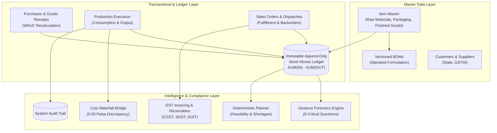

# YieldTrace Architecture & Technical Design Note

## 1. System Overview

YieldTrace is designed as a modular monolith implementing a ledger-driven manufacturing ERP with a Production Variance Forensics intelligence engine. It addresses the fundamental flaw of conventional ERP systems: mutable inventory balances that conceal loss patterns and unexplainable statistical deviations.

---

## 2. Immutable Append-Only Stock Movement Ledger

### Core Principle
**Inventory balances are NEVER directly written, updated, or overwritten.**
Every physical transaction creates a signed movement record in `stock_moves`:
$$\text{Current Physical Balance} = \sum_{\text{direction} = \text{IN}} \text{Quantity} - \sum_{\text{direction} = \text{OUT}} \text{Quantity}$$

### Negative Stock Prevention
Before recording any `OUT` movement (production issue, packaging issue, sales dispatch), the engine asserts:
$$\text{Available Stock} \ge \text{Requested Quantity}$$
If insufficient, an `InsufficientStockError` is raised. Negative inventory is strictly prohibited.

### Auditable Adjustments
Physical stock count reconciliations do not overwrite balances; they calculate the exact difference $\Delta = Q_{\text{target}} - Q_{\text{current}}$ and append a signed `STOCK_ADJUSTMENT` entry with mandatory reason and operator logging in `audit_logs`.

---

## 3. Costing & Variance Forensics Formulas

### 1. Weighted Average Unit Cost (WAUC)
Recalculated upon every purchase receipt:
$$\text{WAUC}_{\text{new}} = \frac{(Q_{\text{current}} \times \text{WAUC}_{\text{current}}) + (Q_{\text{purchase}} \times P_{\text{purchase}})}{Q_{\text{current}} + Q_{\text{purchase}}}$$

### 2. Standard Material Cost Baseline
$$\text{Standard Material Cost} = \sum_{i} (Q_{\text{planned}, i} \times \text{StdCost}_{i})$$

### 3. Material Price Variance
$$\text{Price Variance}_{i} = (P_{\text{actual}, i} - \text{StdCost}_{i}) \times Q_{\text{actual}, i}$$

### 4. Material Usage Variance
$$\text{Usage Variance}_{i} = (Q_{\text{actual}, i} - Q_{\text{planned}, i}) \times \text{StdCost}_{i}$$

### 5. Identity: Material Cost Bridge
$$\sum_{i} (Q_{\text{planned}, i} \times \text{StdCost}_{i}) + \sum_{i} \text{Usage Variance}_{i} + \sum_{i} \text{Price Variance}_{i} = \sum_{i} (Q_{\text{actual}, i} \times P_{\text{actual}, i})$$
*Proof:*
$$\sum [Q_p \cdot S + (Q_a - Q_p) \cdot S + (P_a - S) \cdot Q_a] = \sum [Q_p \cdot S + Q_a \cdot S - Q_p \cdot S + Q_a \cdot P_a - Q_a \cdot S] = \sum (Q_a \cdot P_a) \quad \blacksquare$$

### 6. Mathematical Cost Waterfall Reconciliation
$$\text{Total Actual Batch Cost} = \text{Standard Batch Baseline} + \text{Price Variance} + \text{Usage Variance} + \text{Overhead Variance}$$
Implemented in Python using `Decimal` arithmetic with banking rounding (`ROUND_HALF_UP`) ensuring **₹0.00 paisa discrepancy**.

---

## 4. Packaging Reconciliation Logic

When output is packed into cartons of capacity $C$ (e.g. 20 packets/carton):
1. **Total Boxed Capacity:** $B_{\text{cap}} = N_{\text{cartons}} \times C$
2. **Unboxed Packets:** $U = \max(0, Q_{\text{good}} - B_{\text{cap}})$
3. **Discrepancy Trigger:**
   If $Q_{\text{good}} \neq B_{\text{cap}}$, `packaging_mismatch = True`.
4. **Non-Coercion Rule:**
   The system preserves the exact transaction ($N_{\text{cartons}} = 9$) and **does not silently alter it to 10 cartons**. An `AUDIT_WARNING` is logged and displayed to the supervisor.

---

## 5. Statistical Methodology & CUSUM Production Drift

### Sample Size Threshold Discipline
- **$N < 10$ Observations:** Statistical dispersion cannot be reliably established. The engine falls back to a deterministic 3.0% engineering tolerance and explicitly flags:
  `"Baseline not yet reliable – insufficient historical observations (minimum 10 required)."`
- **$N \ge 10$ Observations:** Computes historical mean ($\mu$), sample standard deviation ($s$), sample median ($\tilde{x}$), and Median Absolute Deviation (MAD):
  $$\text{MAD} = \text{median}(|X_i - \tilde{x}|)$$
  Anomaly threshold is evaluated against the historical $2\sigma$ control envelope.

### CUSUM Control Chart Formulation
Tracks subtle sequential shifts in process parameters (e.g. Cooking oil consumption):
$$S_i^{+} = \max(0, S_{i-1}^{+} + (X_i - \mu_0 - k))$$
$$S_i^{-} = \min(0, S_{i-1}^{-} + (X_i - \mu_0 + k))$$
Where:
- $\mu_0$ = Target mean (0.0% variance)
- $k$ = Allowable slack shift ($0.5\sigma$)
- $h$ = Decision threshold ($3.0\sigma$)
An out-of-control alarm is triggered when $S_i^{+} > h$ or $|S_i^{-}| > h$.

---

## 6. Security Model & Role-Based Access Control

| Permission / Action | Owner | Admin | Salesman | Prod Supervisor | Accountant | Auditor |
| :--- | :---: | :---: | :---: | :---: | :---: | :---: |
| View Main Dashboard | ✅ | ✅ | ✅ | ✅ | ✅ | ✅ |
| Manage Master Catalog | ✅ | ✅ | ❌ | ❌ | ❌ | ❌ |
| Create Sales Orders | ✅ | ✅ | ✅ | ❌ | ❌ | ❌ |
| Execute Production Run | ✅ | ✅ | ❌ | ✅ | ❌ | ❌ |
| Generate GST Invoices | ✅ | ✅ | ❌ | ❌ | ✅ | ❌ |
| Record Customer Payments | ✅ | ✅ | ❌ | ❌ | ✅ | ❌ |
| Inspect Forensic Findings | ✅ | ✅ | ❌ | ✅ | ✅ | ✅ |
| Export Audit Reports | ✅ | ✅ | ❌ | ❌ | ✅ | ✅ |
| Alter Historical Ledger | ⛔ NONE | ⛔ NONE | ⛔ NONE | ⛔ NONE | ⛔ NONE | ⛔ NONE |
